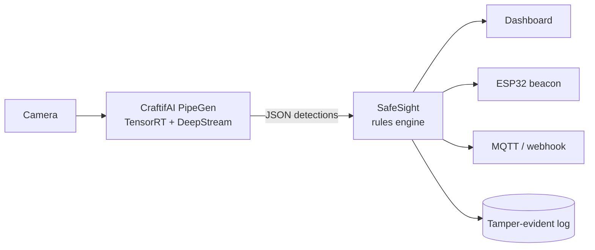

# OverClock

[](https://github.com/abishekss2007/CraftifAIHackathon_CRA004/actions/workflows/ci.yml)
[](https://github.com/abishekss2007/CraftifAIHackathon_CRA004/actions/workflows/cd.yml)

Team OverClock's entry for **Hack With Bangalore 4.0, Track A (CraftifAI PipeGen)**.

## [SafeSight](SafeSight/README.md): a camera that calls for help when a worker goes down

CraftifAI PipeGen builds and runs the perception (person detection, tracking and pose, compiled to TensorRT and run on DeepStream).
SafeSight turns those detections into fall, man-down, danger-zone and crowding alerts, and acts on them through a live dashboard,
an ESP32 siren beacon, MQTT and webhooks.



* Live demo: https://safesight-demo.vercel.app
* Full documentation, architecture and run instructions: [SafeSight/README.md](SafeSight/README.md)
* CI/CD: [`.github/workflows`](.github/workflows) runs lint, tests on Python 3.9 to 3.13, a server smoke test, a browser end-to-end test,
  Mermaid diagram rendering and the ESP32 firmware build on every push.

```bash
git clone https://github.com/abishekss2007/CraftifAIHackathon_CRA004 && cd CraftifAIHackathon_CRA004/SafeSight
python3 -m safesight --source sim      # then open http://localhost:8080
```
