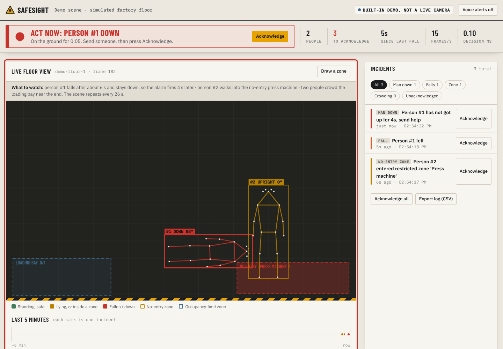
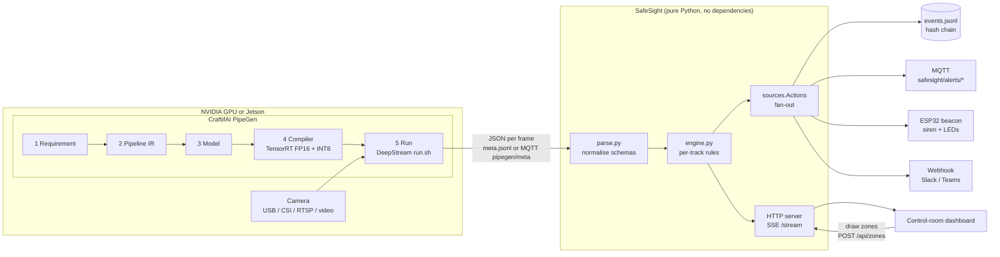
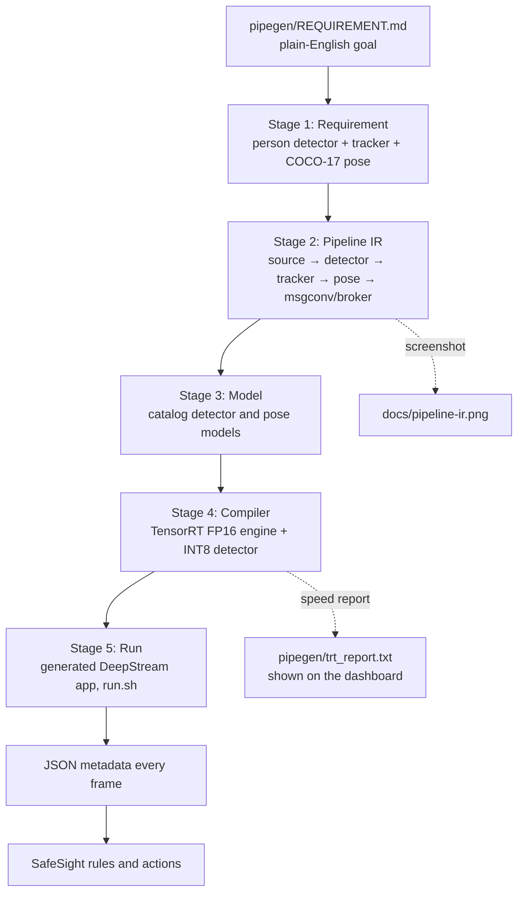
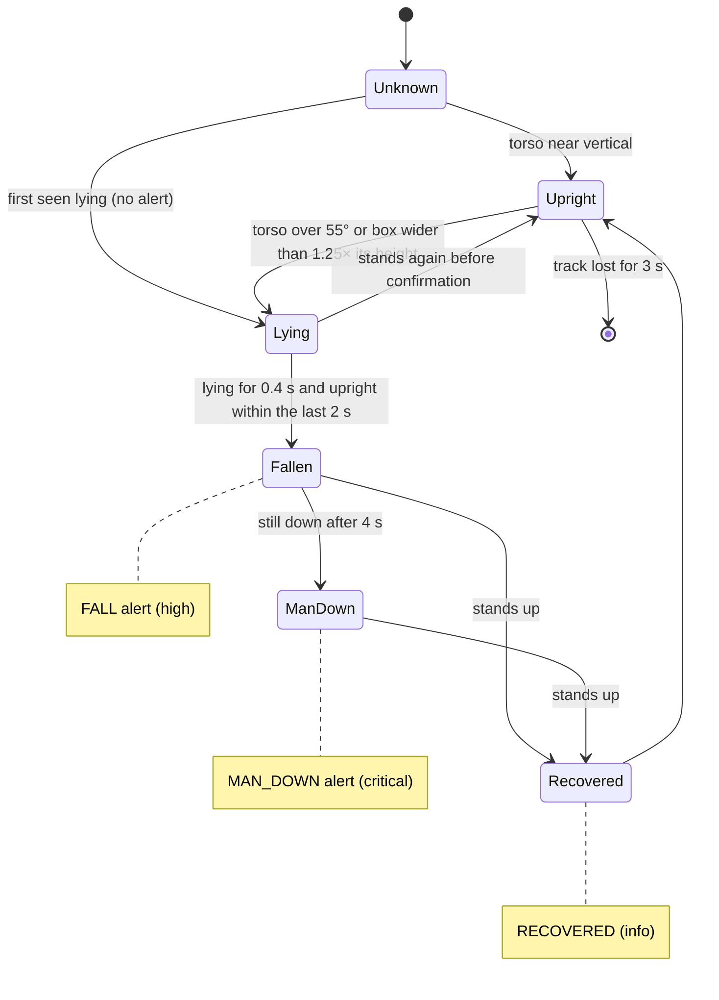
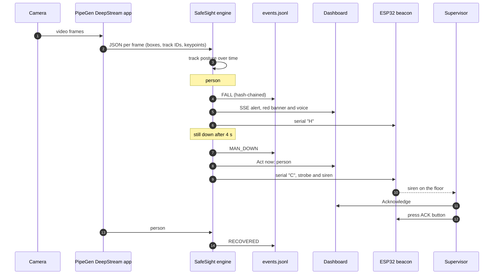
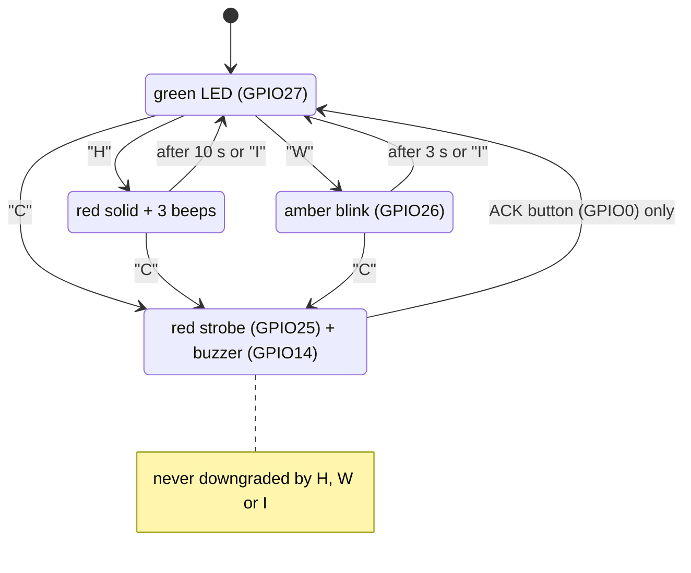
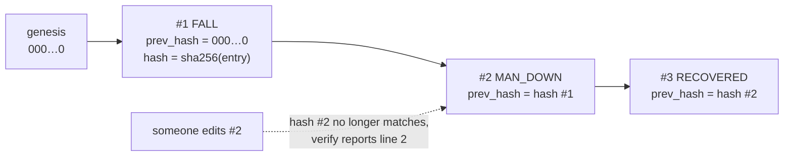
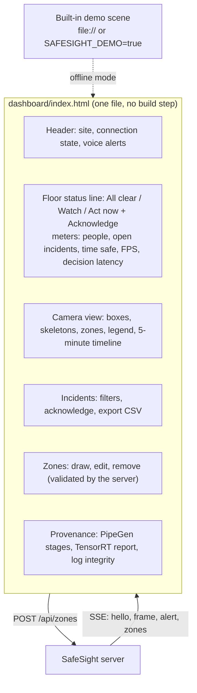
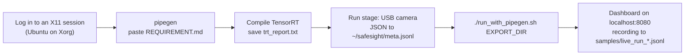
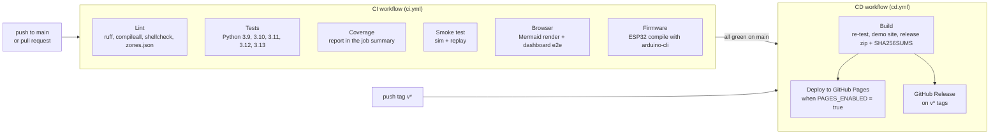

# SafeSight: a camera that calls for help when a worker goes down

[](https://github.com/abishekss2007/OverClockCraftifAIHackathon_CRA004/actions/workflows/ci.yml)
[](https://github.com/abishekss2007/OverClockCraftifAIHackathon_CRA004/actions/workflows/cd.yml)


**Hack With Bangalore 4.0 · Track A: PipeGen (Computer Vision and Edge AI)**
Problem areas: workplace safety and fall detection. Bonuses: Closed Loop and Edge Optimization.

**Try it now:** [live demo](https://safesight-demo.vercel.app) (built-in scripted scene, no camera needed) ·
[pitch script](PITCH.md) · [Track A checklist](TRACK_A_CHECKLIST.md)



---

## Contents

1. [The problem](#the-problem)
2. [What SafeSight does](#what-safesight-does)
3. [Architecture](#architecture)
4. [How PipeGen is load-bearing](#how-pipegen-is-load-bearing)
5. [Detection rules](#detection-rules)
6. [Alert flow, end to end](#alert-flow-end-to-end)
7. [Closed loop: the ESP32 beacon](#closed-loop-the-esp32-beacon)
8. [Tamper-evident incident log](#tamper-evident-incident-log)
9. [Dashboard](#dashboard)
10. [Quick start](#quick-start)
11. [Running live with PipeGen](#running-live-with-pipegen)
12. [Command-line reference](#command-line-reference)
13. [HTTP API](#http-api)
14. [Input formats](#input-formats)
15. [Testing](#testing)
16. [CI/CD](#cicd)
17. [Repository layout](#repository-layout)
18. [Design decisions](#design-decisions)
19. [Evidence for the judges](#evidence-for-the-judges)

---

## The problem

Workers get hurt on factory floors and in warehouses every year. The most dangerous minutes often come
*after* the accident, while nobody has noticed yet. Most sites already have CCTV, but nobody watches it live.

## What SafeSight does

SafeSight turns an ordinary camera into a safety officer that never looks away.

| Capability | What happens |
|---|---|
| **Fall detection** | Spots the moment a tracked person goes from standing to lying, using the torso angle from pose keypoints, with a bounding-box fallback. |
| **Man-down escalation** | If the person is still down after 4 s, SafeSight raises a **critical** alarm. |
| **Recovery** | When the person stands up again, SafeSight logs that they are back on their feet. |
| **Danger zones** | Draw a polygon around a press machine or forklift lane in the dashboard. Anyone who stays inside for 0.5 s triggers an alert. |
| **Crowding** | Per-zone occupancy limits, for example only one person in the loading bay. |
| **Physical alerts** | Live control-room dashboard, an **ESP32 siren beacon** over serial, MQTT alerts, and a webhook (Slack, Discord or Teams). |
| **Audit trail** | Every alert goes into a hash-chained log, so any later edit is detectable. |

## Architecture



The heavy compute (detection, tracking, pose) runs in PipeGen's TensorRT engines on the GPU. SafeSight is the
decision and action layer on top. It takes about 0.1 ms per frame, so it runs comfortably on a Jetson next to the pipeline.

## How PipeGen is load-bearing

PipeGen *is* the perception layer. SafeSight has no vision model of its own: every box, track ID and skeleton
it reasons about comes from the DeepStream app that PipeGen generated and compiled.



**Proof during the demo:** press Ctrl+C on PipeGen's `run.sh`. Within 2 s the dashboard shows **No PipeGen feed**,
the people disappear from the view, and no alert can fire. Restart it and detections come back.

## Detection rules

Each tracked person runs through this state machine in `safesight/engine.py`:



| Rule | Default | Alert | Severity | Beacon |
|---|---|---|---|---|
| Lying posture | torso angle > 55° or box aspect > 1.25 | | | |
| Fall confirmed | lying ≥ 0.4 s, upright within the last 2 s | `FALL` | high | `H`: red solid, 3 beeps |
| Man down | still down 4 s after the fall | `MAN_DOWN` | critical | `C`: red strobe and siren until ACK |
| Recovered | stands up after a fall | `RECOVERED` | info | `I`: green |
| Zone breach | inside a restricted zone ≥ 0.5 s | `ZONE_BREACH` | warning | `W`: amber blink |
| Overcrowding | more people than the zone's `max_people` | `OVERCROWD` | warning | `W`: amber blink |
| Cooldown | the same alert for the same person or zone is muted for 8 s | | | |

All thresholds live in `DEFAULTS` in `safesight/engine.py` and can be passed to `Engine(**cfg)`.

## Alert flow, end to end



## Closed loop: the ESP32 beacon

The firmware in `firmware/safesight_beacon` was specified for FirmGen in [`firmware/FIRMGEN_PRD.md`](firmware/FIRMGEN_PRD.md).
SafeSight sends one character per alert over USB serial at 115200 baud.



Wiring: LEDs (each with a series resistor) on GPIO25 (red), GPIO26 (amber) and GPIO27 (green), an active buzzer on GPIO14, and the
on-board BOOT button (GPIO0) as ACK. Run SafeSight with `--serial /dev/ttyUSB0` (needs `pip install pyserial`).

## Tamper-evident incident log

Every alert written to `events.jsonl` carries the SHA-256 hash of the alert before it. Editing or deleting any
past incident breaks the chain from that line onward, which matters for safety audits and insurance claims.



```bash
python3 -m safesight.verify events.jsonl
# OK: 3 incidents, hash chain intact
# TAMPERED: chain breaks at line 2 (after 1 good incidents)   (exit code 1)
```

The dashboard calls `/api/integrity` every 10 s and shows the result under the provenance panel.

## Dashboard



* **Floor status line:** one plain sentence, so anyone glancing at the screen knows what to do.
* **Colour legend** under the camera view. The same colours are used everywhere.
* **Voice alerts** (top right): beeps and reads each incident aloud, for control rooms where nobody is staring at the screen.
* **Honest states:** *Connecting*, *Live*, *No PipeGen feed*, *SafeSight server stopped*, or *Built-in demo, not a live camera*. It never shows fake live data.
* Works at phone width, and in light and dark themes.

## Quick start

Needs Python 3.9 or newer. The core has no pip dependencies.

**Windows:** double-click `OPEN-DEMO.html` for the built-in browser demo (no Python needed), or `START.bat` to run the real server
and open http://localhost:8080.

```bash
git clone https://github.com/abishekss2007/OverClockCraftifAIHackathon_CRA004 && cd OverClockCraftifAIHackathon_CRA004/SafeSight

# Rehearsal mode: scripted factory scene, no GPU needed
python3 -m safesight --source sim
# open http://localhost:8080 and turn on Voice alerts
```

In the scripted scene, person #1 falls at about 6 s, becomes man-down at about 10 s and gets up at 15 s. Person #2 walks into the
Press machine zone, and persons #3 and #4 crowd the Loading bay. The scene repeats every 26 s.

## Running live with PipeGen



```bash
./run_with_pipegen.sh /path/to/pipegen/export     # starts run.sh, SafeSight and the dashboard together

# or by hand
./run.sh                                          # inside the PipeGen export folder
python3 -m safesight --source file:$HOME/safesight/meta.jsonl --report pipegen/trt_report.txt
python3 -m safesight --source mqtt://localhost:1883/pipegen/meta   # needs pip install paho-mqtt

# replay a recorded session (backup demo)
python3 -m safesight --source replay:samples/demo_meta.jsonl
```

`run_with_pipegen.sh` records every payload to `samples/live_run_HHMM.jsonl`, adds `--report` when `pipegen/trt_report.txt`
exists, and adds `--serial /dev/ttyUSB0` when a beacon is plugged in. Full GPU-machine steps are in [TRACK_A_CHECKLIST.md](TRACK_A_CHECKLIST.md).

## Command-line reference

| Flag | Default | Meaning |
|---|---|---|
| `--source` | `sim` | `sim`, `file:PATH` (follows the file like `tail -F`), `replay:PATH`, `mqtt://host:port/topic`, or `stdin` |
| `--zones` | `zones.json` | Zone file. Saving zones in the dashboard writes it back. |
| `--port` | `8080` | Dashboard and API port |
| `--fps` | `15` | Frame rate of the scripted scene |
| `--from-start` | off | With `file:`, read the file from the beginning instead of the end |
| `--record PATH` | | Save every raw payload, to replay later |
| `--log PATH` | `events.jsonl` | Hash-chained alert log |
| `--webhook URL` | | POST each alert as `{"text": ..., "event": ...}` |
| `--alerts-mqtt HOST[:PORT]` | | Publish alerts on `safesight/alerts/<severity>` (needs `paho-mqtt`) |
| `--serial PORT` | | ESP32 beacon, for example `/dev/ttyUSB0` (needs `pyserial`) |
| `--report PATH` | | PipeGen TensorRT speed report to show on the dashboard |

## HTTP API

| Method | Path | Returns |
|---|---|---|
| GET | `/` | The dashboard |
| GET | `/stream` | Server-Sent Events: `hello` (zones and recent alerts), `frame`, `alert`, `zones` |
| GET | `/api/zones` | Current zone list |
| POST | `/api/zones` | Replace the zones. Validated: at most 50 zones, unique names up to 40 characters, 3 to 64 corners inside 0..1, `max_people` 1 to 50. Bad input gets `400 {"error": ...}`, and bodies over 64 KB get `413`. |
| GET | `/api/events` | The last 200 alerts |
| GET | `/api/integrity` | `{"ok": true, "entries": N, "bad_line": null}` |
| GET | `/api/report` | The TensorRT report text, or 404 |
| GET | `/api/config` | Source, rule thresholds and whether a report is loaded |

Zone file format (coordinates are fractions of the frame width and height):

```json
[{"name": "Press machine", "restricted": true, "polygon": [[0.66, 0.82], [0.98, 0.82], [0.98, 0.98], [0.66, 0.98]]},
 {"name": "Loading bay", "restricted": false, "max_people": 1, "polygon": [[0.02, 0.80], [0.30, 0.80], [0.30, 0.99], [0.02, 0.99]]}]
```

## Input formats

`safesight/parse.py` accepts what PipeGen and DeepStream can emit and normalises it to one frame shape:

| Format | Example |
|---|---|
| Requested PipeGen output | `{"frame", "ts", "source", "width", "height", "objects": [{"id", "label", "confidence", "bbox": [x1, y1, x2, y2], "keypoints": [[x, y, score] × 17]}]}` |
| nvmsgconv minimal schema | `"objects": ["7\|100\|100\|160\|300\|Person"]` |
| nvmsgconv full schema | `{"sensorId", "object": {"id", "type", "bbox": {"topleftx", "toplefty", "bottomrightx", "bottomrighty"}}}` |
| Other box styles | `[x, y, w, h]` with `"bbox_format": "xywh"`, `{left, top, width, height}`, `{left, top, right, bottom}`, `{x1, y1, x2, y2}` |

Keypoints are optional. Without them SafeSight falls back to the bounding-box aspect ratio, so a detector-only INT8 engine still works.
Malformed payloads are skipped, so one bad line never stops the monitor. Samples are in `samples/`.

## Testing

```bash
python3 -m unittest -v            # 21 tests: rules, parser, sources, HTTP server, evidence chain
tools/smoke.sh sim                # real server: API, 400 on bad zones, FALL + MAN_DOWN, tamper detection
tools/smoke.sh replay             # the same against the recorded sample

cd tools && npm ci && npx playwright install chromium && cd ..
python3 tools/build_demo.py site && (cd site && python3 -m http.server 8000 &)
node tools/e2e.mjs demo http://127.0.0.1:8000/     # headless Chromium: demo mode, fall appears, no errors, no phone overflow
node tools/e2e.mjs live http://127.0.0.1:8080/     # the same against python3 -m safesight --source sim
node tools/check_mermaid.mjs README.md             # every diagram in this file renders
```

| Suite | Covers |
|---|---|
| `tests/test_engine.py` | Full scenario with pose and box-only, lying-from-start is not a fall, minimal schema, point-in-polygon, zone validation, evidence chain |
| `tests/test_io.py` | Every input schema and box format, file tailing, replay, webhook delivery, `safesight.verify` exit codes |
| `tests/test_server.py` | Real HTTP server: dashboard, every API endpoint, 404, zone POST validation and persistence |
| `tools/smoke.sh` | The CLI end to end, in `sim` and `replay` modes |
| `tools/e2e.mjs` | The dashboard in a real browser, in demo and live modes |
| `tools/check_mermaid.mjs` | Every Mermaid diagram parses and renders with the real Mermaid library |

## CI/CD

Both workflows live in `.github/workflows/` at the repository root.



| Workflow | Trigger | Jobs |
|---|---|---|
| **CI** (`ci.yml`) | push to `main`, every pull request, manual | `lint`, `test` (5 Python versions), `coverage`, `smoke` (sim and replay), `browser` (Mermaid and dashboard e2e), `firmware` (ESP32 compile) |
| **CD** (`cd.yml`) | CI succeeded on `main`, a `v*` tag, manual | `build` (demo site and release bundle as artifacts), `pages` (optional), `release` (tags only) |

**Turning on GitHub Pages:** Settings → Pages → Source: *GitHub Actions*, then Settings → Secrets and variables → Actions → Variables → add
`PAGES_ENABLED` = `true`. Until then, the `pages` job is skipped and everything else still runs.

**Cutting a release:** `git tag v1.0.0 && git push origin v1.0.0` publishes a release with `safesight-v1.0.0.zip` and its checksum.

Dependabot (`.github/dependabot.yml`) keeps the Actions versions and the browser-test tooling up to date.

## Repository layout

| Path | What |
|---|---|
| `safesight/parse.py` | Normalises PipeGen / DeepStream JSON |
| `safesight/engine.py` | Per-track state machine, zone dwell, crowding, cooldowns |
| `safesight/sources.py` | Inputs (tail, replay, MQTT, stdin), actions (log, MQTT, serial, webhook), hash chain |
| `safesight/__main__.py` | Pipeline thread, HTTP server, SSE stream, zone validation |
| `safesight/simulate.py` | Scripted 26 s factory scene for rehearsals and tests |
| `safesight/verify.py` | `python -m safesight.verify`: checks the incident log |
| `dashboard/index.html` | Control-room UI, one file, no build step |
| `firmware/safesight_beacon/` | ESP32 sketch: strobe, siren, amber and green LEDs, ACK button |
| `firmware/FIRMGEN_PRD.md` | FirmGen PRD for the Closed Loop bonus |
| `pipegen/REQUIREMENT.md` | The exact PipeGen requirement and the stage evidence checklist |
| `samples/` | Recorded session and DeepStream schema samples |
| `tests/` | Python test suites |
| `tools/` | Smoke test, demo-site builder, browser e2e test, Mermaid validator |
| `run_with_pipegen.sh` | One command for the live demo on the GPU machine |
| `START.bat`, `OPEN-DEMO.html` | Windows one-click launchers |
| `PITCH.md`, `TRACK_A_CHECKLIST.md` | Pitch script and Track A requirement mapping |

## Design decisions

* **Fall ≠ lying down.** A fall is only raised when the tracked person was upright within the last 2 s. Someone already lying under
  a machine for maintenance does not trigger alarms, and a unit test covers it.
* **Pose first, box fallback.** The torso angle from shoulder and hip keypoints is robust to camera angle. The aspect-ratio
  fallback keeps it working with a detector-only pipeline.
* **Edge-friendly.** The decision layer is pure Python with no dependencies, at about 0.1 ms per frame. All heavy compute stays in
  PipeGen's TensorRT engines.
* **Privacy.** Only metadata (boxes and keypoints) leaves the GPU box. SafeSight never stores or streams video.
* **Fail loud, not silent.** If detections stop for 2 s, the dashboard says *No PipeGen feed* instead of showing an empty, calm floor.

## Evidence for the judges

| Claim | Proof |
|---|---|
| PipeGen ran all 5 stages | `docs/pipeline-ir.png` and stage screenshots |
| TensorRT engine built | `pipegen/trt_report.txt` (FP16 vs INT8), also shown on the dashboard |
| Runs live on hardware | Live demo on a USB camera, plus `samples/live_run_*.jsonl` recorded from PipeGen's real output |
| Actionable output | `events.jsonl` alerts, MQTT `safesight/alerts/*`, ESP32 siren |
| PipeGen is load-bearing | Stop PipeGen's `run.sh` mid-demo: the dashboard flips to **No PipeGen feed** and no alerts can fire |
| It works | The CI badge at the top: tests on 5 Python versions, a real-server smoke test, a browser e2e test and the firmware build |
